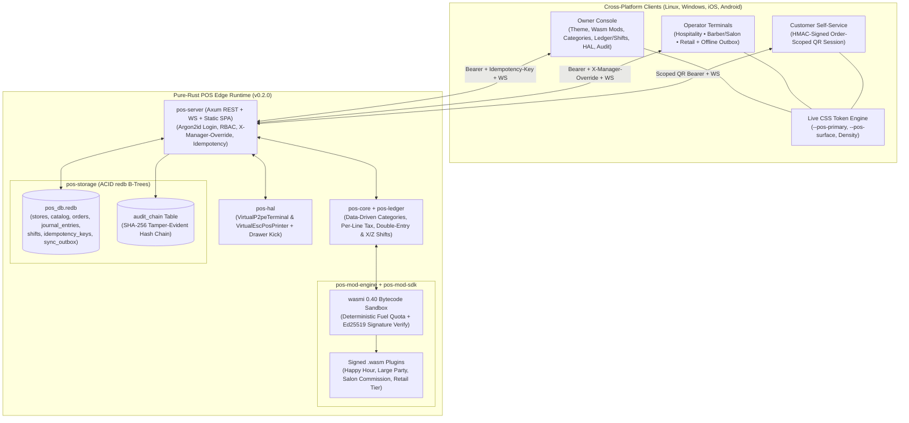

# Point-of-Sale (POS) System Architecture (`v0.2.0`)

To build a Point-of-Sale (POS) system that is simultaneously **secure**, **moddable**, **scalable**, and **fast**—while running across **Linux, Windows, iOS, and Android** for both **Operators** and **Customers** with full **Store Theming**—OmniPOS Edge uses a **Local-First, Cross-Platform Edge Architecture** powered by a **7-Crate Pure-Rust Workspace**, a **Real `wasmi` + Ed25519 Signed WebAssembly Mod Sandbox**, an **ACID `redb` Multi-Store Storage Engine**, a **Double-Entry Accounting & Shift Ledger**, a **PCI-P2PE & ESC/POS Hardware Abstraction Layer (`pos-hal`)**, and a **Modular Reactive UI Shell (Tauri v2 + React/TypeScript)**.

Furthermore, the platform synthesizes the industry-leading workflow strengths of **NCR Aloha POS** and **Toast POS**, while providing a **Non-Destructive Multi-Store / Multi-Vertical Partition Engine** supporting **Restaurants & Bars**, **Barber & Hair Salons**, **Retail Stores**, and custom merchant categories out of the box.

---

## 1. Rust Workspace & Frontend Module Topology

| Component / Crate | Responsibility |
| :--- | :--- |
| **`crates/pos-core`** | Data-driven `CategoryConfig` & `PrepStationConfig` (replacing rigid enums), mixed-mode per-line `TaxRule` math (`Exclusive`, `Inclusive`/VAT, `Exempt`), `Order` lifecycle (Aloha pivot seat splits, equal splits, comps, partial/full refunds), **Argon2id** PIN hashing with 5-attempt brute-force lockout, and **HMAC-SHA256** signed RBAC + Customer-scoped + Manager Step-Up tokens. |
| **`crates/pos-ledger`** | Immutable **Double-Entry Accounting Ledger** (`JournalEntry::new_checked` enforcing `Debits == Credits` across `CashInDrawer`, `CardProcessorReceivable`, `GrossMerchandiseSales`, `SalesTaxPayable`, `StaffTipsPayable`, `PromotionalDiscountsContra`, `ManagerCompsContra`, `SalesRefundsContra`) and **Cash Drawer Shifts** (Open Float, Paid-In/Paid-Out, Safe Blind Drop, Mid-Shift **X-Report**, and End-of-Day **Z-Report** variance reconciliation). |
| **`crates/pos-hal`** | **Hardware Abstraction Layer** traits & virtual simulators: `PaymentTerminal` (`VirtualP2peTerminal` supporting `preauth`, `incremental_auth`, `capture`, `sale`, `void_auth`, and `refund` using opaque `P2PE-TOK-*` tokens—zero raw PANs in host RAM) and `ReceiptPrinter` (`VirtualEscPosPrinter` emitting genuine binary ESC/POS streams `ESC @`, alignment, bold, `GS V` cut, and `ESC p` RJ-11 cash drawer kicks). |
| **`crates/pos-mod-sdk`** | Versioned guest/host WebAssembly ABI (`POS_MOD_ABI_VERSION = 1`), packed 64-bit `(ptr, len)` linear-memory helpers, and JSON/scalar hook contracts for third-party `.wasm` mod authors. |
| **`crates/pos-mod-engine`** | Real **`wasmi` (`0.40`) WebAssembly Sandbox** compiling & executing genuine `\0asm` binary modules with deterministic **CPU instruction fuel metering**, linear-memory caps, WASI capability enforcement, and **`ed25519-dalek` cryptographic signature verification** over `(id \| version \| capabilities \| wasm_bytes)`. |
| **`crates/pos-storage`** | **ACID Indexed Storage on `redb`** (`pos_db.redb` + `InMemoryBackend` for tests) partitioned by `store_id` (`store-hospitality`, `store-salon`, `store-retail`) across B-tree tables (`stores`, `operators`, `catalog`, `orders`, `mods`, `journal_entries`, `shifts`, `audit_chain`, `idempotency_keys`, and `sync_outbox`). Switching stores/verticals never overwrites tenant data. |
| **`crates/pos-server`** | Axum REST + WebSocket Edge Hub with `AuthenticatedSession` / `OptionalSession` extractors, **Manager PIN Step-Up Override** (`X-Manager-Override`) enforcement, **`Idempotency-Key`** deduplication, sequence-numbered WebSocket sync deltas, signed Customer QR link minting, and static SPA hosting (`frontend/dist`) for LAN handhelds and guest phones. |
| **`frontend/` & `src-tauri/`** | Modular React/TypeScript UI (`HeaderBar`, `PinLoginModal`, `ManagerOverrideModal`, `ReceiptPreviewModal`, `OperatorPosView`, `CustomerSelfServiceView`, `OwnerConsoleView`), dynamic LAN/Hub endpoint discovery, localStorage offline mutation outbox queue, and compilable **Tauri v2** desktop/mobile shell (`#[cfg_attr(mobile, tauri::mobile_entry_point)]`). |

---

## 2. Synthesizing the Best of Aloha POS & Toast POS

| Capability Pillar | Inspired By | How OmniPOS Edge Implements It |
| :--- | :--- | :--- |
| **Pivot Seating & 1-Tap Split-by-Seat** | **Aloha POS** | Every line item can be assigned to `Seat 1..N` or shared across the table. `Order::split_by_seat` computes exact-cent per-seat checks alongside $N$-way equal splits. |
| **Conversational Modifiers & Course Pacing** | **Aloha POS** | Modifiers support prefix qualifiers (`No`, `Light`, `Extra`, `On Side`), and line items track `Held → Fired → Ready → Served` KDS pacing. |
| **Manager Step-Up PIN Overrides & Comps** | **Aloha POS** | Voiding an already-fired item, comping an item, issuing a payment refund, or closing a Z-Report requires either Manager/Owner RBAC or a short-lived signed `X-Manager-Override` token approved via Manager PIN (`9999` / `1111`). |
| **Offline-First Terminal Redundancy** | **Aloha POS** | ACID `redb` B-tree persistence on the local Edge Hub + client-side offline command queue with `Idempotency-Key` replay protection. |
| **Pre-Authorized Tabs & Card-on-File** | **Toast POS** | Bar tabs and salon appointments bind P2PE pre-authorization holds (`P2PE-AUTH-*`) via `pos-hal`, captured automatically on closeout. |
| **Live Item Countdowns & Instant 86'ing** | **Toast POS** | Catalog items track real-time `stock_count` badges; hitting zero auto-86's the item and broadcasts sequence-numbered deltas over `/ws`. |
| **Cryptographically Scoped Guest QR Pay** | **Toast POS** | Operators mint HMAC-SHA256 signed QR URLs (`/?qr_token=...&order=...`) strictly scoped to a single `order_id` (deny-by-default isolation—guests cannot enumerate or pay other tables). |

---

## 3. Multi-Vertical Store Partitions & Per-Line Tax Engine

Each store partition in `redb` owns its own `StoreTheme`, `CategoryConfig` list (merchants can add custom categories dynamically via `POST /api/catalog/categories` without recompiling Rust), `PrepStationConfig` list, `CatalogItem`s, `Order`s, `JournalEntry` ledger, and `CashDrawerShift`s:

1. **Hospitality (`store-hospitality`):** Craft Taproom & Kitchen with Aloha Pivot Seats, Toast Pre-Auth Tabs, *15% Craft Happy Hour* `.wasm` mod, and *18% Large Party Auto-Gratuity* `.wasm` mod.
2. **Barber & Hair Salon (`store-salon`):** Chair & Colorist Appointment Board mixing **0% tax-exempt services** (`TaxMode::Exempt`) and **8.25% taxable apothecary retail** (`TaxMode::Exclusive`) on the same check, with category-prorated tax math and `.wasm` *15% Retail Care Bundle + 45%/10% Stylist Commission* calculation.
3. **Retail Store (`store-retail`):** Barcode/UPC fast scanner (`01942500101`), variant modifiers, SKU stock countdowns, and `.wasm` *10% Off 3+ Units Bundle*.

---

## 4. Cross-Platform Runtime Strategy (Linux, Windows, iOS, Android)

| Target Platform | Form Factor & Primary Role | Packaging & Integration |
| :--- | :--- | :--- |
| **Linux** | Stationary Bar/Counter Register, KDS, Store Edge Hub | **Tauri v2 (WebKitGTK)** embedding `pos-server` + `redb` (`frontend/src-tauri`), direct ESC/POS & USB HID barcode scanner access. |
| **Windows** | Countertop Retail PC, Back-Office & Owner Console | **Tauri v2 (WebView2)** `.msi`/`.exe` embedding `pos-server` + `redb`. |
| **iOS (iPhone / iPad)** | Tableside Server Handheld, Stylist iPad, Customer QR | **Tauri v2 Mobile (`#[tauri::mobile_entry_point]`)** paired over LAN to Store Edge Hub + Zero-Install Safari QR Web App served directly from `pos-server`. |
| **Android** | Smart Handheld Terminals (PAX, Sunmi), Kiosk, Customer QR | **Tauri v2 Mobile** in COSU Kiosk Mode + Zero-Install Chrome QR Web App. |

---

## 5. System Architecture Diagram

